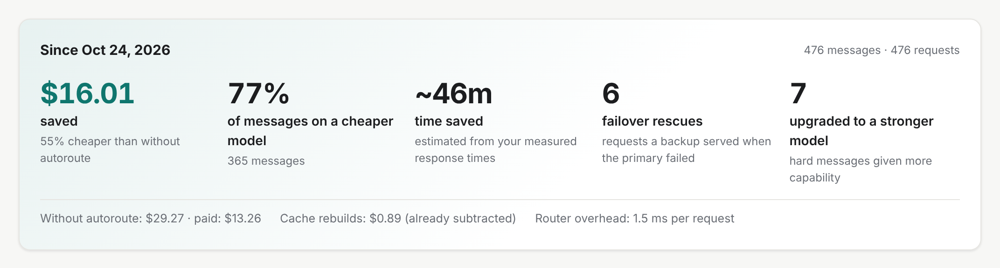
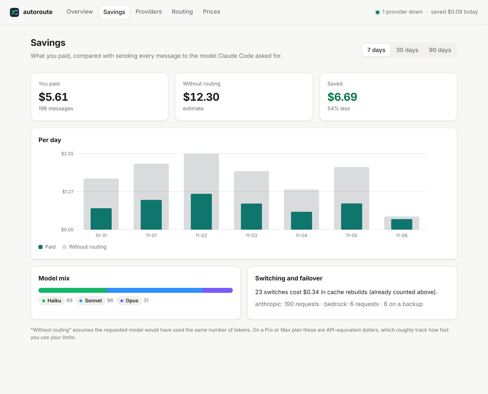
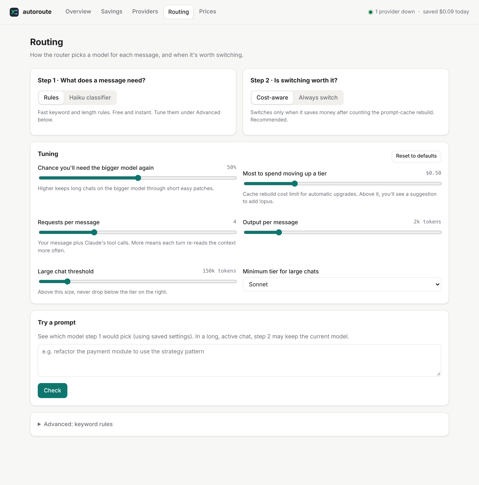

# claude-autoroute

**Spend less on Claude Code without thinking about models, and keep working when a provider goes down.**

`claude-auto` runs Claude Code through a small local router. For every message you send, the router picks **Haiku**, **Sonnet** or **Opus**. It only switches when the switch saves money once prompt-cache costs are counted. If your provider fails, it moves the request to a backup you configure: Amazon Bedrock, Google Vertex AI, or any gateway that speaks the Anthropic Messages API.

```
you ──► Claude Code ──► claude-autoroute (127.0.0.1) ──► Anthropic      (primary)
                          1. what does this message need?    ├─► Bedrock    (backup)
                          2. is switching worth it?          ├─► Vertex AI  (backup)
                          3. which provider is healthy?      └─► gateway    (last resort)
```

<picture>
  <source media="(prefers-color-scheme: dark)" srcset="docs/value-dark.png">
  
</picture>

> **Status: alpha.** Automated tests run the router against mock providers; CI runs them on Linux and macOS.
> Run `autoroute savings` after a week to see whether it pays off for you.
> This is an independent community project, not affiliated with or endorsed by Anthropic. You're responsible for using it within your provider's terms.

- **Measured, not claimed.** It records what it actually saved you, from real token counts and response times, and shows it in a dashboard and in `autoroute stats`.
- **Zero dependencies.** Plain Node.js (20+), nothing to audit beyond this repo.
- **Private by default.** Prompt text is never written to disk. Credentials are never sent anywhere except to the provider they belong to. No telemetry.
- **For Claude Code CLI with an API key, Amazon Bedrock or Google Vertex AI.** Any Claude Code arguments pass straight through. See [what's supported](#whats-supported) before installing.

---

## Contents

- [What's supported](#whats-supported)
- [Install](#install)
- [Quick start](#quick-start)
- [How it decides](#how-it-decides)
- [What it's doing for you](#what-its-doing-for-you)
- [The dashboard](#the-dashboard)
- [Quick settings: what gets used when](#quick-settings-what-gets-used-when)
- [Free local model for easy tasks](#free-local-model-for-easy-tasks)
- [Failover to other providers](#failover-to-other-providers)
- [Commands](#commands)
- [Configuration](#configuration)
- [Privacy and security](#privacy-and-security)
- [Limitations](#limitations)
- [FAQ](#faq) (more in [HELP.md](HELP.md))
- [Contributing](#contributing)

## What's supported

Check this first. It decides whether claude-autoroute is for you.

### Apps

| App | Supported? |
|---|---|
| **Claude Code CLI** (`claude` in a terminal) on **macOS** or **Linux** | ✅ **Yes.** This is what claude-autoroute is built for. Start it with `claude-auto`. |
| Claude Code in VS Code, JetBrains, or the Claude desktop app | ❌ Not yet. These start Claude Code their own way, so they don't go through `claude-auto`. Untested. |
| Claude desktop app (chat, Cowork), claude.ai on the web, mobile apps | ❌ **No.** They talk to Anthropic's own service. The desktop app's third-party inference mode replaces your Claude sign-in and expects an HTTPS gateway, which claude-autoroute isn't. |
| Windows | ❌ Not supported (untested). |

### Accounts and plans

| How Claude Code is signed in | Supported? |
|---|---|
| **Claude API key** (from Claude Console, billed per token) | ✅ **Yes.** Recommended. Per-token billing is where routing saves the most. |
| **Amazon Bedrock** (Claude models, Bedrock API key) | ✅ **Yes**, as the main provider or as a backup |
| **Google Vertex AI** (Claude models, gcloud login) | ✅ **Yes**, as the main provider or as a backup |
| **Your company's LLM gateway** (`ANTHROPIC_BASE_URL` + a gateway token) | ✅ **Yes.** claude-autoroute forwards to it. |
| **Claude Free, Pro or Max** subscription login | ❌ **No.** Anthropic does not allow third-party tools to route requests through Free, Pro or Max plan credentials ([Claude Code legal and compliance](https://code.claude.com/docs/en/legal-and-compliance)). claude-autoroute detects these logins and refuses them with an explanation, and nothing is forwarded. |
| **Claude Team or Enterprise** subscription login | ⚠️ **Only with your admin's approval.** Your organization's agreement with Anthropic governs this. Off by default; turn it on with `"subscriptionLogin": "allow-team-enterprise"`. Subscription logins look the same for every plan, so this setting is your confirmation, not something the router can check. |
| **A free local model** (Ollama, LM Studio, llama.cpp) for easy tasks | ✅ **Optional**, off by default. Easy messages run free on your own computer, and Claude does the rest. It isn't Claude, so answers can differ. See [Free local model](#free-local-model-for-easy-tasks). |
| Other vendors (e.g. Gemini via LiteLLM) | ⚠️ As a last-resort **backup** only, through a paid gateway: see [`examples/gateway-other-vendor.jsonc`](examples/gateway-other-vendor.jsonc). Anthropic doesn't support Claude Code on non-Claude models. |

**It isn't a multi-vendor router.** It routes between Claude models. Non-Claude models are only an optional backup or an optional local model for easy tasks, and both are off by default.

To see how you're signed in, run `/status` in Claude Code. The dashboard's setup checklist also shows the login type once Claude Code connects.

### Your organization's model rules

If your admin limits which models people can use (Claude Code's `availableModels`), claude-autoroute **never routes to a model outside that list**, not even with a `!opus`-style override. It reads the restriction from:

- managed settings (`/Library/Application Support/ClaudeCode/` on macOS, `/etc/claude-code/` on Linux), including `managed-settings.d/`
- settings from your organization's admin console, as cached by Claude Code
- your own `~/.claude/settings.json`

Project-level `.claude/settings.json` restrictions aren't visible to the router, because one router serves all your sessions. Claude Code still enforces them for the model it asks for. You can also limit routing yourself with `allowedTiers`.

## Install

You need **Node.js 20 or later** (Node 18 is end-of-life) on **macOS or Linux**.

```bash
# in the downloaded or cloned folder
./install.sh
```

The installer needs no admin rights: if npm's global folder isn't writable, it installs into `~/.local`. It downloads nothing, and the installed copy doesn't depend on the folder you ran it from. Then it starts the guided setup.

This installs two commands: `claude-auto` (use it in place of `claude`) and `autoroute` (manage the router). Prefer npm directly? Use `npm install -g .` or `npm install -g github:braggy/claude-autoroute`, then run `autoroute setup`.

## Quick start

```bash
autoroute setup                # a few questions: your login, shadow mode, status line, then a self-test
claude-auto                    # use exactly like `claude`; all arguments pass through
autoroute stats                # what it saved (or, in shadow mode, would have saved), plus a trial check
```

**Start risk-free with shadow mode.** autoroute decides as usual but changes nothing, and records what routing would have saved. That includes cache rebuild costs, so the estimate isn't flattering. Turn routing on with `autoroute shadow off` once you're happy. **On a work laptop with Claude Team or Enterprise,** follow HELP.md: "Set up on a work laptop". Admins deciding whether to approve it: read [ADMIN.md](ADMIN.md).

Prefer to configure by hand? `autoroute init` writes a fully commented config file, and `autoroute doctor` checks your setup. `autoroute ui` opens the dashboard.

To make plain `claude` route too, add `alias claude=claude-auto` to your shell profile.

## How it decides

**Step 1: what does this message need?**

| Your message looks like… | Wants |
|---|---|
| `git status`, rename, fix a typo, format, run tests | 🟢 Haiku |
| everyday coding: add a feature, write a test, explain code | 🔵 Sonnet |
| architecture, refactors, migrations, race conditions, root-cause debugging, security, long or multi-step prompts | 🟣 Opus |
| `yes`, `go ahead`, `continue` | same as last turn |

The default rules are fast keyword and length checks. Set `"classifier": { "type": "llm" }` to have Haiku classify each new message instead. That's smarter, costs about $0.0001 and adds about 0.5 s per message.

**Step 2: is switching worth it?**

Each model keeps its own prompt cache. In a long chat on Opus or Sonnet 5.5, rebuilding the cache costs about **25 times** as much as reading it. Using real prices and whether each model's cache is still warm, the router estimates this turn's cost on the current model and on the new one, including the cost of coming back later. Then:

- **Small chats:** switch freely. Cache costs are pennies.
- **Long, active chats:** a single `git status` stays on Opus. A run of easy tasks does drop to Haiku, because the switch cost is spread over the streak.
- **Moving up a tier:** this is a quality decision, so it's allowed unless the cache rebuild alone costs more than `maxUpgradeCacheCostUSD` ($0.50). In that case the status line suggests `!opus` so you can force it.
- **Idle for 5+ minutes:** the cache has expired anyway, so switching is free.

**Always:**

- **One model per turn:** Claude's tool calls for a message stay on the same model.
- **Background calls aren't re-routed:** Claude Code's own Haiku calls (titles, summaries) pass through unchanged.
- **Overrides:** `!opus`, `!sonnet` or `!haiku` anywhere in a message forces that model. The tag is removed before the model sees it.
- **Fallbacks:** if a model rejects a request after a switch, the router removes old thinking blocks and retries. If that fails, it falls back to the model Claude Code asked for.

## What it's doing for you

Every number is measured from your own traffic. Estimates are labeled as estimates.

```
$ autoroute stats
autoroute since 10/24/2026

  saved              $16.01  (55% cheaper than without autoroute)
  paid               $13.26  vs $29.27 estimated without it
  messages           476  (77% handled by a cheaper model)
  upgraded           7 hard message(s) given a stronger model
  regrets            3 time(s) you typed !opus/!sonnet right after a cheaper pick (1% of cheaper picks)
  failover rescues   6 request(s) served by a backup when the primary failed
  time saved         ~46m (estimated from your measured response times)
  router overhead    1.5 ms per request
  cache rebuilds     $0.89 across 58 switch(es), already subtracted
```

*(Example output from the demo data.)*

| Metric | How it's measured |
|---|---|
| **Paid** | Token counts reported by the provider on every response, times the configured prices |
| **Without autoroute** | The same tokens priced at the model Claude Code asked for. Cache rebuilds caused by switching are priced as the cheap cache reads they would have been. *Estimate:* assumes the same number of tokens. |
| **Cheaper-model share** | Messages that ran on a cheaper model than requested |
| **Upgrades** | Messages that ran on a stronger model than requested. They cost more, and they're counted honestly in "paid". |
| **Regret rate** | How often you typed `!opus` or `!sonnet` straight after the router picked a cheaper model than requested, as a share of cheaper picks. This is the quality check: a high rate means the router is being too thrifty. |
| **Failover rescues** | Requests a backup provider served after the primary failed |
| **Time saved** | For each message on a different model, the requested model's average response time (measured on your own traffic, once there are at least 5 samples) minus the actual time. *Estimate.* |
| **Router overhead** | Time the router spends deciding, per request |
| **Cache rebuilds** | The extra cost of the first request after each switch, already subtracted from "saved" |

**For other tools:** status bars, tmux, menu-bar widgets and scripts can read `GET http://127.0.0.1:8787/__autoroute/status`. Send the header `x-autoroute-key` with the value from `~/.claude-autoroute/local-key`. It returns today's spending, lifetime savings, provider health, local model speed and the last decision, and never prompt text. The Claude Code status line reads a small file instead, so it stays instant even when the router is busy.

`autoroute stats --json` prints the same numbers as JSON, so you can track them over time or share them in an issue. The JSON contains no prompt text.

## The dashboard

`autoroute ui` opens a dashboard in your browser. It works the same way on macOS and Linux.

- **Overview:** lifetime value (as above), today's spend, provider health with a "retry now" button, a setup checklist with one-click fixes, and a live feed of each message's model and the reason for it.
- **Savings:** daily chart of paid vs. without autoroute, model mix, switching and failover counts.
- **Providers:** add Bedrock, Vertex or a gateway from a template, store API keys, test a connection (a 1-token request, under $0.001), reorder failover, and set when to fail over.
- **Routing:** choose the classifier and switching mode, tune with sliders that explain themselves, and try a prompt to see which model it would get.
- **Prices:** edit the price table used for decisions and reports.
- **Help:** searchable answers and troubleshooting (the same text as [HELP.md](HELP.md)), a summary of anything in your setup that needs attention, and **Copy diagnostics**. That copies a support snapshot for bug reports with keys, prompts, web addresses, provider names and your username removed. `autoroute diagnostics` prints the same snapshot.

<details><summary>Screenshots: Savings and Routing (demo data)</summary>





</details>

**Add it to your Dock:** `autoroute app install` adds an "autoroute" app with its own icon. Clicking it starts the router if needed and opens the dashboard.

| | What you get |
|---|---|
| **macOS** | `~/Applications/autoroute.app`, in Launchpad and Spotlight. Finder opens with it selected so you can drag it to the Dock. |
| **Linux** | A standard app entry with icons, in the app grid or menu. Add `--dock` to pin it to the GNOME dock (Ubuntu's default). On other desktops, pin it from the app menu. |

The app runs `autoroute ui` through your login shell, so the router sees the same environment variables as your terminal. `autoroute app remove` takes it away again. The dashboard's setup checklist also has an **Add app icon** button.

**API keys** go into your operating system's secure storage:

| | Where keys are stored |
|---|---|
| **macOS** | Keychain (built in) |
| **Linux** | Secret Service: GNOME Keyring or KWallet, via `secret-tool`. Install it with `sudo apt install libsecret-tools`, or the equivalent for your distribution. |

The dashboard can't read a key back after it's saved. If no secure storage is available, it says so and suggests an environment variable instead. It never falls back to a plain file.

**On a remote machine over SSH:** `autoroute ui` prints the link and the `ssh -L` command to reach it from your own computer.

**Saving from the dashboard** rewrites `config.jsonc` without comments. The previous version is kept as `config.jsonc.bak`, and every setting stays documented in `config.example.jsonc`.

## Quick settings: what gets used when

The dashboard's Overview has one-click switches, saved instantly. Each also works from a terminal:

| Setting | What it does | Terminal |
|---|---|---|
| **Routing: On / Shadow / Paused** | **Shadow** decides but changes nothing, and shows what routing would save. **Paused** sends Claude Code's requests through unchanged; failover still works. | `autoroute shadow on` / `off`, `autoroute pause` / `resume` |
| **Free local model: On / Off** | Easy tasks on your local model, or not | `autoroute local on` / `off` |
| **Priority** | One click picks a matching set of settings, and the dashboard shows what each changes: **Lowest cost**, **Balanced** (the default), **Fastest** (Claude only, no cache-cost hesitation), **Best quality** (no Haiku or local model; moves up to Opus freely) | `autoroute priority <name>` |
| **Providers** | Switch an account off to skip it. Change the order on the Providers page. | `autoroute provider <name> on` / `off` |

**Speed guard for the local model:** the router times the local model and Claude on the same kind of easy task. If the local model is more than **2x slower** on average, easy tasks go back to Claude. Every tenth one re-checks, so it notices when the local model speeds up again. You can change the limit, or set "no limit". The Overview shows both measured times.

## Free local model for easy tasks

Optional. Easy messages (git commands, renames, typos) can run on an open-source model on your own computer, which is free and keeps your code on your machine. Claude keeps everything else.

- **Turn it on** in the dashboard: Providers → **Free local model for easy tasks**. Or use [`examples/local-model.jsonc`](examples/local-model.jsonc).
- **Setup guide:** the [step-by-step guide and model suggestions](HELP.md#free-local-models) work the same on macOS and Linux. It includes the one setting people miss: Ollama's default context length is too small for Claude Code.
- **The same cost check applies.** In a long chat with a warm Claude cache, leaving Claude can cost more than it saves, so the message stays on Claude.
- **Safe by default:**
  - Your Claude credentials never reach the local server.
  - Claude-only fields and thinking blocks are removed from requests to it.
  - Big chats stay on Claude.
  - If the local model returns an error, the request goes to Claude.
  - If your organization restricts models, the local model is used only when it's on the allowed list.
- **Honest numbers:** messages on it are counted as $0 in the statistics, and the dashboard and status line label them "local".

## Failover to other providers

Add providers to your config and list them in `failover.order`. Ready-made examples are in [`examples/`](examples):

| Example | Backup | Credential |
|---|---|---|
| [`bedrock-failover.jsonc`](examples/bedrock-failover.jsonc) | Claude on Amazon Bedrock (Anthropic-compatible Mantle endpoint) | Bedrock API key in `AWS_BEARER_TOKEN_BEDROCK` |
| [`vertex-failover.jsonc`](examples/vertex-failover.jsonc) | Claude on Google Vertex AI | `gcloud auth print-access-token` |
| [`gateway-other-vendor.jsonc`](examples/gateway-other-vendor.jsonc) | Another vendor via LiteLLM or a similar gateway | gateway key in an env var |

**What triggers failover:** HTTP 500, 502, 503, 504, 529 and network errors (connection refused, DNS failures, timeouts). Add 429 with `"onRateLimit": true`, for example to keep working when you hit your plan's usage limits.

**Cooldown:** a failed provider is skipped for `cooldownSeconds` (300). Chats stay on the backup instead of bouncing, because every switch costs a cache rebuild. After the cooldown, the primary is tried again.

**Credentials stay separate:** your Anthropic API key or login is removed from every request sent to a backup, and each backup gets only its own credential. The config validator refuses to forward your Anthropic credentials to anything but the primary.

**Visible in Claude Code:** when failed over, the status line shows `🟠 failover: bedrock`.

Prefer Claude on Bedrock or Vertex as your first backup. It's the same model, so behavior and tool use don't change, and the only cost is one cache rebuild.

## Commands

| Command | What it does |
|---|---|
| `claude-auto [args]` | Start the router if needed, then run `claude [args]` through it |
| `autoroute setup` | Guided first-time setup: your login, shadow mode, status line, self-test. Flags: `--login api-key\|enterprise\|cloud`, `--admin-approved`, `--no-shadow`, `--yes` |
| `autoroute selftest` | Send one tiny message through Claude Code and the router (well under a cent) and check that everything works |
| `autoroute shadow on` / `off` | Shadow mode: decide but don't change models, and record what routing would save |
| `autoroute ui` | Open the dashboard (one-time link; `--no-open` just prints it) |
| `autoroute pause` / `resume` | Stop or restart changing models (failover keeps working) |
| `autoroute local on` / `off` | Use the free local model for easy tasks, or not |
| `autoroute priority <name>` | `lowest-cost`, `balanced`, `fastest` or `best-quality` |
| `autoroute provider <name> on` / `off` | Switch a provider on or off |
| `autoroute status [--json]` | Router, providers, local model speed, last decision |
| `autoroute app install [--dock]` / `app remove` | Add or remove the "autoroute" app icon for the dashboard |
| `autoroute config path` | Show where the config file is |
| `autoroute version` | Show the installed version |
| `autoroute llms` | All the docs in one file for an AI assistant |
| `autoroute diagnostics` | A support snapshot that's safe to share: no keys, prompts, URLs, provider names or paths |
| `autoroute stats [--json]` | Lifetime value: money and time saved, cheaper-model share, rescues, regret rate, shadow-mode results, and a first-week trial check |
| `autoroute init` | Write the documented config to `~/.claude-autoroute/config.jsonc` |
| `autoroute doctor` | Check Node, Claude Code, config, credentials and status line |
| `autoroute status` | Router health, provider health, last decision |
| `autoroute savings [days]` | What you paid vs. an estimate without routing (default 7 days) |
| `autoroute log [lines]` | Follow the decision log, e.g. "wanted haiku, stayed on opus because…" |
| `autoroute explain "<prompt>"` | Dry run of step 1 for a prompt |
| `autoroute start` / `stop` / `restart` | Manage the background router |
| `autoroute statusline install` / `remove` | Add or remove the Claude Code status line |

The status line looks like this:

```
myproject  🟢 auto:haiku · saves ~$0.07 · today $1.03 (saved $0.44)
```

## Configuration

The config file is `~/.claude-autoroute/config.jsonc`. It allows comments, and every key is optional. [`config.example.jsonc`](config.example.jsonc) documents every setting with its default. Changes take effect within about 2 seconds without a restart, except `host` and `port`. Run `autoroute doctor` after editing.

The settings people change most:

| Key | Default | Effect |
|---|---|---|
| `classifier.type` | `"heuristic"` | `"llm"` for smarter classification |
| `switching.mode` | `"cost-aware"` | `"always"` follows step 1 and ignores cache cost |
| `switching.maxUpgradeCacheCostUSD` | `0.5` | Lower means fewer upgrades in long chats |
| `switching.returnProbability` | `0.5` | Higher means more reluctant to drop down in long chats |
| `failover.order` | `["anthropic"]` | Providers to try, primary first |
| `failover.onRateLimit` | `false` | Also fail over on 429 |
| `prices` | Nov 2026 list prices | Update when prices change |

Environment variables:

| Variable | Effect |
|---|---|
| `AUTOROUTE_HOME` | Runtime folder (default `~/.claude-autoroute`) |
| `AUTOROUTE_PORT` | Overrides `port` |
| `AUTOROUTE_UPSTREAM` | Overrides the primary provider's `baseUrl` |
| `AUTOROUTE_DEBUG=1` | Also print the log to stderr when running `autoroute serve` |

If `ANTHROPIC_BASE_URL` is already set (you use a gateway), `claude-auto` forwards to it.

## Privacy and security

- **Local only.** The router listens on `127.0.0.1` and makes no network requests except to the providers you configure. There is no telemetry.
- **Requests must carry a local key.** Each request needs a random secret header that `claude-auto` adds. Other programs on your machine can't use the router to spend your backup credentials.
- **Prompts are never stored.** Prompt text isn't written to disk. The log records the chosen model and the reason, and stats record token counts. Set `logPromptSnippets` to log the first 60 characters of each prompt for debugging.
- **Owner-only files.** The runtime folder and its files are readable only by you (`0700` / `0600`).
- **No secrets in config.** Credentials come from the OS keychain, environment variables or commands, never from the config file. `autoroute doctor` warns if you paste one in.
- **The dashboard is locked down.** It opens only through a one-time link from `autoroute ui`, accepts requests only from this machine, and has CSRF and DNS-rebinding protection and a strict Content Security Policy. See [SECURITY.md](SECURITY.md).
- **Credentials only go to their own provider.** See [Failover](#failover-to-other-providers).

See [SECURITY.md](SECURITY.md) for the threat model and how to report a vulnerability, and [ADMIN.md](ADMIN.md) for a data-flow summary and an approval checklist.

## Limitations

- **A reply already in progress can't fail over.** If a provider fails partway through streaming a reply, that reply is lost. Claude Code's retry goes to the backup.
- **Some endpoints only go to the primary.** Requests other than `/v1/messages`, such as token counting, aren't failed over.
- **Claude Code's model label doesn't change.** It keeps showing the model you launched with. The status line shows the real pick.
- **Savings are estimates.** "Without routing" assumes the original model would have used the same number of tokens.
- **macOS and Linux only.** Windows is untested.
- **Backups bill separately.** Bedrock, Vertex and gateways each charge per token on their own accounts.
- **Claude Code CLI only.** See [What's supported](#whats-supported).

## FAQ

The most common questions are below. [HELP.md](HELP.md) has the full set, plus troubleshooting and a glossary. It's also built into the dashboard.

**Using an AI assistant?** [`llms-full.txt`](llms-full.txt) has all the docs in one file for AI assistants, and [`llms.txt`](llms.txt) is the short index (the [llms.txt](https://llmstxt.org) convention). The dashboard's Help page has a **Copy help for an AI assistant** button, and `autoroute llms` prints the file.

**Does switching models waste tokens?**
It can, which is why the router counts the cost first. See [How it decides](#how-it-decides). `autoroute savings` reports the cache-rebuild cost of every switch, already subtracted from your savings.

**Is it a multi-vendor router?**
No. It picks between Claude models. You can add another vendor as a last-resort backup through a gateway such as LiteLLM ([example](examples/gateway-other-vendor.jsonc)). Use a paid tier: free tiers, including Gemini's, may use your prompts for training.

**Can I use it at work?**
Yes. On top of the noncommercial licence, an [additional permission](ADDITIONAL-PERMISSION.md) allows internal use at any organisation, including a company. Team and Enterprise logins also need your admin's approval: point them to [ADMIN.md](ADMIN.md).

**Can I use a free tier of another vendor for simple tasks?**
You can configure it, but it's rarely worth it. Haiku 5.5 already costs a fraction of a cent per simple turn, switching vendors throws away the prompt cache, and free tiers may use your prompts, which here means your code, for training.

**Does it work with a Pro or Max subscription?**
No. Anthropic doesn't allow third-party tools to route requests through Free, Pro or Max plan credentials, so claude-autoroute refuses those logins. Use a Claude API key, Bedrock or Vertex. Team and Enterprise plans need your admin's approval. See [What's supported](#whats-supported).

**Can I use it with the Claude desktop app?**
No. The desktop app's chat and Cowork talk to Anthropic directly, and Claude Code inside the desktop app or an IDE doesn't start through `claude-auto`. claude-autoroute is for the Claude Code CLI on macOS and Linux.

**Why not a Claude Code hook?**
Hooks can add context or block a prompt, but they can't change the model. A local proxy, set through `ANTHROPIC_BASE_URL` (Claude Code's documented gateway setting), can.

## Contributing

See [CONTRIBUTING.md](CONTRIBUTING.md). In short: no runtime dependencies, tests for every behavior change, and `npm test && npm run check:secrets` must pass.

## License

[PolyForm Noncommercial 1.0.0](LICENSE). Copyright (c) 2026 Steve Bragg.

Free for personal use, study, testing and other noncommercial purposes. An [additional permission](ADDITIONAL-PERMISSION.md) also allows internal use at any organisation, including a company. Selling it, bundling it in a product or offering it as a service needs a separate licence: open an issue to ask.
